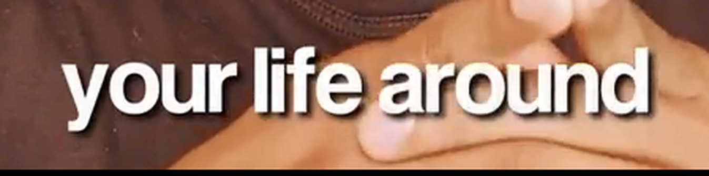
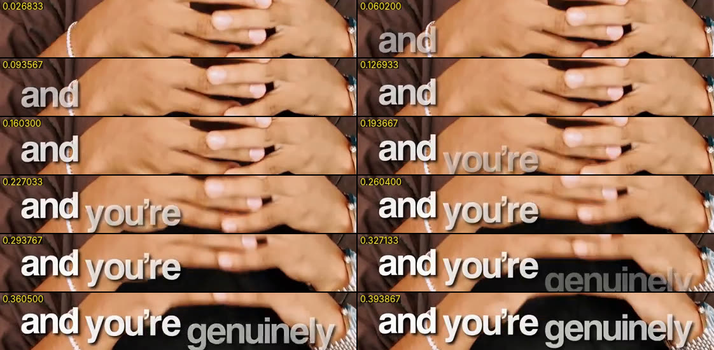
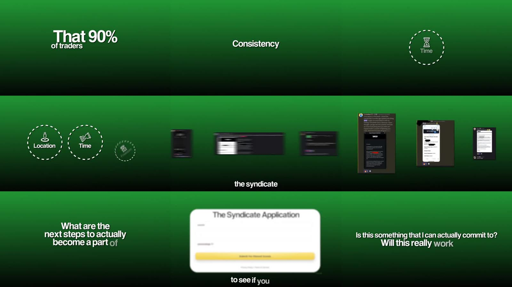
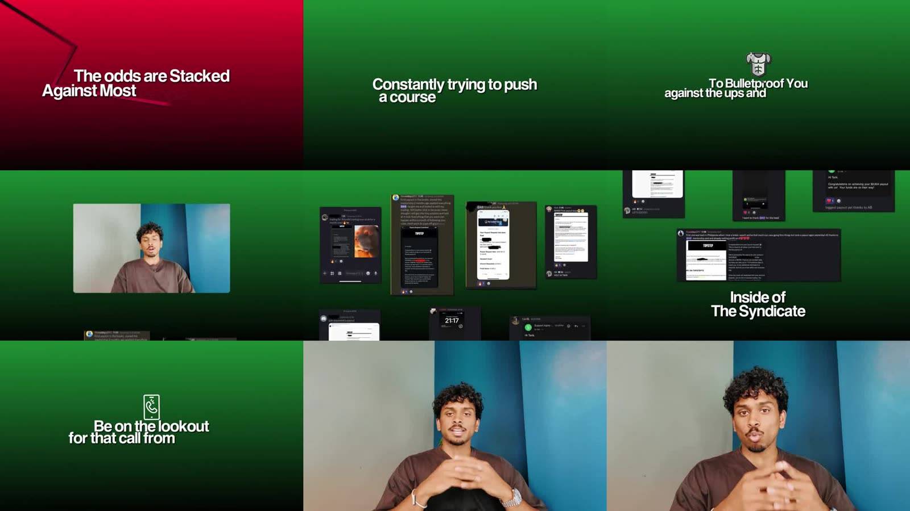
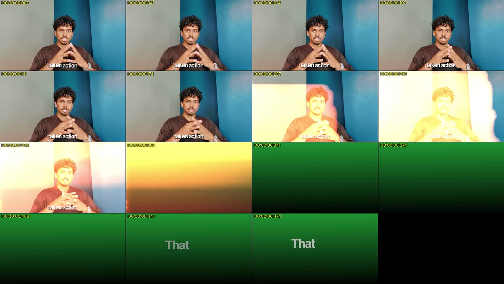
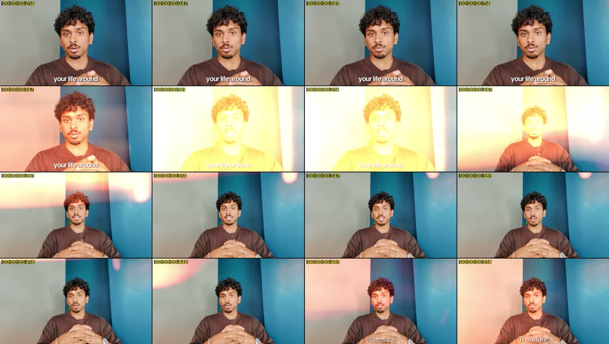
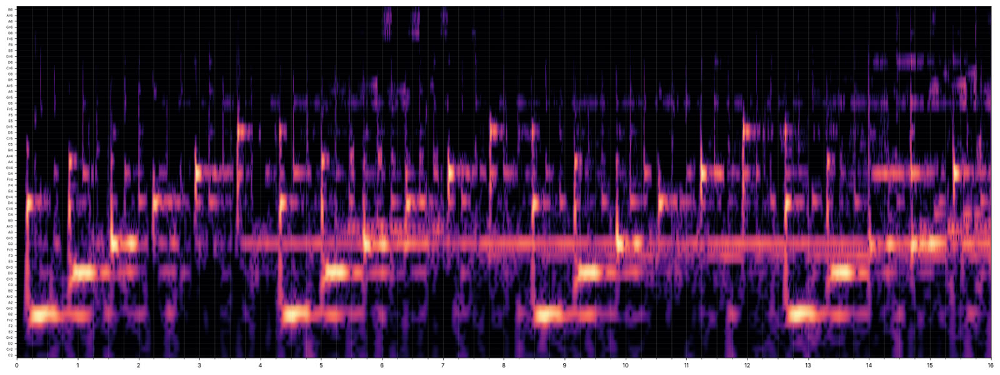
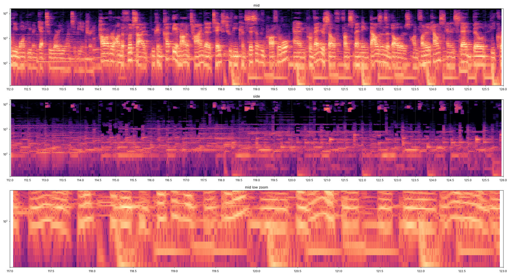

# AB Nasdaq thank-you video: full breakdown

Source: `abnasdaq-thankyou.mp4` from the
[Thank-you VSL reference release](https://github.com/eliascroesus/rickyvsl-clips/releases/tag/thank-you-vsl-reference).
It is 2:41 (161.4 s), 1280×720, 29.97 fps, BT.709, stereo 48 kHz, −16.4 LUFS.

Everything below was measured from the file, not guessed:

- the speech was transcribed with word timings;
- every frame was scanned for cuts, flashes and card colour;
- the zoom was measured frame-to-frame by image registration;
- every on-screen word was read by OCR at 10 frames a second;
- the audio was split into centre (voice) and sides (music).

The raw data is in [`analysis/`](analysis) and the stills are in [`frames/`](frames).

## 1. The whole video in one table

| Element | What AB does |
|---|---|
| Shot | One locked-off medium shot: grey and teal wall, brown tee. His face is about 16 % of the frame width. |
| Edit pace | Every pause is cut out; the longest gap left is 0.48 s. He speaks 191 words a minute. |
| Captions | White, bold, tight tracking, bottom centre (centre at 92.7 % of the height). Words build up one at a time, 1–3 per phrase (median 2). Each new word slides up from grey to white in 0.1 s. |
| Graphics | 11 full-screen graphics, 26 % of the runtime. Ten are on a **green gradient** (#1F9233 → black), one is on a **red gradient** (#DA0032 → black). |
| Card text | The same font as the captions. The spoken words build up word by word **in sync with his voice**, centred, 1–2 lines. |
| Transitions | An orange/yellow **light leak (film burn)**, about 0.2 s bright and 0.5 s in total, on 25 of the 26 transitions. The cut happens under the brightest frame. |
| Zoom | Smooth 0.6–1.0 s ease-in-out pushes of 1.12–1.25×. They are **stacked in 2 steps up to about 1.4×** on key lines, then reset to wide with a light-leak flash or a smooth 0.7–1.0 s pull-out. |
| Music | One instrumental bed from the first frame: G minor, 130 BPM. A piano/pluck arpeggio of fifths and octaves runs over a soft pad. **An 808 bass (G1) comes in at 1:58** on "however, on the flip side…". The bed sits about 19 dB under the voice and fades out over the last 0.5 s. |
| Sound effects | **None.** There are no whooshes, risers, clicks, dings or booms, even on the light leaks, and no ducking. Only voice and music. |

## 2. Second-by-second timeline

Legend: **LL** = light-leak transition, **G** = green card, **R** = red card, **push** = smooth zoom in, **pull** = smooth zoom out.
Zoom factors are relative to the wide shot.

| Time | Picture | Words (what triggers it) |
|---|---|---|
| 0:00.0 | Face. **Opens tight at 1.5× and eases out to wide in 1.1 s.** Captions start on the first word. | "Yo what's up, AB here" |
| 0:03.7 | Push 1.22× (0.4 s), then pull back at 0:05.0 | "thank you for filling out the application" |
| 0:06.6 | Jump cut | "you've taken action" |
| 0:07.5 | **LL → G1**: "That 90% / of traders couldn't do". Big first line, smaller second line, built word by word. Captions off. | "that 90% of traders couldn't do" |
| 0:10.0 | LL → face. Push 1.18× at 0:10.2, push 1.22× at 0:12.7, reaching **1.39×**. | "you're genuinely one step closer to changing your life around" |
| 0:14.0 | **LL flash, reset to wide** | "Therefore…" |
| 0:16.0 | Push 1.13× (0.8 s), pull 0.84× at 0:18.8 | "take this extremely seriously" |
| 0:20.1 | **LL → G2**: "Consistency / Profitability". Then three icons in **dashed circles** pop in: Time (centre), then Location (spins in left), then Freedom (spins in right). | "consistency, profitability… time, location and financial freedom" |
| 0:25.6 | LL → face | "that you've always been wanting" |
| 0:27.1 | **LL → G3**: testimonial screenshots (dark Discord or chat cards) **slide in from the right one after another with motion blur**, settling in a row of 3. Captions stay on. | "countless other traders inside the syndicate…" |
| 0:31.6 | LL → face. Jump cut 0:34.1, push 1.17× at 0:34.3 | "so there's no reason why you can't as well" |
| 0:35.5 | **LL → G4**: "What are the / next steps to actually / become a part of / The Syndicate?" (4 lines, word by word) | the same words |
| 0:39.4 | LL → face. Push 1.15× (1.0 s) at 0:40.9. | "one of my best students…" |
| 0:42.1 | **LL → G5**: "The Syndicate Application". A white rounded card with a **blurred screen recording of the form** grows from a dot (0.5 s, ease-out). Captions stay on. | "is currently reviewing your application" |
| 0:45.7 | Plain hard cut → face (the only transition without a leak) | "a good fit to the program" |
| 0:47.1 | LL flash. Push 1.19× at 0:48.3, push 1.25× at 0:50.8, reaching **1.38×**. | "he will reach out to you personally, so make sure you have your phone in your hand" |
| 0:52.2 | **LL flash, reset.** Push 1.13× at 0:54.7, push 1.16× at 0:56.1, reaching **1.37×**. | "you do not want to miss out on this call… super super important" |
| 0:57.0 | **LL flash, reset.** Wide and **static for 6.6 s** (calm, empathetic). | "Now I know what you're probably feeling… hesitant" |
| 1:03.6 | **LL → G6**: "Is this something that I can actually commit to? / Will this really work out?" (his inner doubts as on-screen text) | the same words |
| 1:07.3 | LL → face | "etc, and honestly man, I totally get it" |
| 1:09.4 | **LL → R1 (red)**: "The odds are Stacked / Against Most People In Trading". A **dark-red zig-zag "falling chart" line draws itself** from the top left to the bottom right behind the text. | the same words |
| 1:12.5 | LL → face, static | "especially right now online… a ton of misinformation" |
| 1:16.6 | **LL → G7**: a **flicker montage of 12 YouTube "guru" thumbnails**, 2 frames each (0.07 s), centred with rounded corners. The last one blurs out into "Constantly trying to push / a course into your face". | "with trading gurus constantly trying to push a course into your face" |
| 1:20.4 | LL → face. Push 1.22× at 1:23.4, push 1.17× at 1:24.4, reaching **1.36×**. Then a **smooth pull-out 0.73× over 0.7 s** at 1:25.4 (no flash). | "…mentoring you, holding you accountable" |
| 1:26 – 1:41 | Face. Gentle push and pull pairs (1.09×, 1.11×, 0.95×, 0.94×, 1.11×). Jump cuts at 1:30.0, 1:39.2 and 1:40.4. | "that is exactly why I built the Syndicate… real guidance… mentorship and accountability" |
| 1:41.9 | **LL → G8**: a 3D armour-vest icon pops in, then "To Bulletproof You / against the ups and down in Trading" | the same words |
| 1:45.1 | LL → face. Push 1.12× (1.0 s) at 1:49.1. | "you can probably figure things out on your own… way longer" |
| **1:58.3** | **Music: the 808 comes in** (G1, one long note per bar, every 1.85 s, through to the end) | "**however, on the flip side**, you can cut the amount of time…" |
| 2:00 – 2:10 | Face. Push 1.12× at 2:02.4; jump cut 2:08.4; push 1.21× (0.9 s) at 2:08.5; **LL flash, reset** at 2:10.0 | "build the correct psychology… a profitable day trader" |
| 2:11.5 | **The face shrinks into a rounded PiP window** (1.0 → 0.55×) on green and slides up and away. **A wall of testimonial screenshots scrolls up** from the bottom. The title "Inside of / The Syndicate" rises with it. Captions off. | "scroll down below this video and check out the testimonials… inside of the Syndicate" |
| 2:17.7 | LL → face. Push 1.13× at 2:21.1, push 1.07× at 2:24.4, reaching about **1.5×** at its tightest. Then a **smooth pull-out 0.69× over 1.0 s** at 2:27.9. | "these are regular people… more freedom, more control and more opportunity" |
| 2:35.7 | **LL → G9**: phone line icon, then "Be on the lookout / for that call from my team" | the same words |
| 2:38.0 | LL → face, **static wide** to the end. The music fades over the last 0.5 s. | "Thanks once again for applying and I will see you inside" |

## 3. Captions

- **Font:** a neo-grotesk bold (SF Pro Display Bold / Inter Bold class): single-storey "g", straight-tailed "y", curly
  apostrophe, **tight tracking** (about −2 %). Mostly lower case. Proper nouns and a few stress words get Title Case:
  "The Syndicate", "A Ton of misinformation", "Trading Guru's", "Trading Strategy".
- **Size:** about 56–58 px cap-to-descender at 720p (OCR box median 58 px), so **about 85 px on a 1080p canvas**.
  That is bigger than the main-VSL captions (78 px). The ascender height is about 42 px at 720p.
- **Colour:** off-white #FBFFFC (pure white with a hair of warmth).
- **Shadow:** a soft dark drop shadow, offset about 2–3 px down and to the right at 720p, blur about 3 px, about 50–60 %
  black. There is no outline and no box.
- **Position:** centred horizontally; text centre at **92.7 % of the height** (baseline at about 95 %), which is very
  low.
- **Build:**
  - words are added **one at a time** in sync with the voice; the phrase grows to 1–3 words (median 2; 80 phrases
    of 1 word, 94 of 2, 41 of 3, a handful of 4–6 when he talks fast);
  - each phrase is on screen for about 0.5 s on average;
  - the phrase is replaced as a whole, never scrolled;
  - 227 phrases in 2:41.
- **Word animation:** a new word enters **about 50 % grey, about 6–8 px low and slightly soft**. Over 3–4 frames
  (0.10–0.13 s) it rises into place and turns full white. Earlier words stay put.
- **When captions are off:**
  - on every full-screen text card, because the card text *is* the caption;
  - during the PiP/testimonial wall, where the title replaces them.
- **When captions stay on:**
  - over the green screenshot montage;
  - over the application card;
  - over the guru-thumbnail flicker.
- No sound on captions.

## 4. Full-screen cards

**Background:**

- A plain vertical linear gradient, flat across the width, with no texture or grain.
- Green, top to bottom: #1F9233, #1C872F, #177026, #14581F, #0D3F15, #07270D, #010300 at the bottom.
- Red: #DA0032, #B7002A, #920020, #6F0018, #480010, #250008, #030101.

**Text:**

- The same bold font as the captions, white, with the same soft drop shadow.
- Single words are about 57 px cap height at 720p (about 86 px at 1080p).
- Long lines run a little smaller so they fit.
- Text sits slightly above the middle; the block centre is at 40–48 % of the height.
- Every line is centred.

**Word build** ([frames](frames/ty-07-card-word-build.jpg)):

- Words appear **exactly when he says them**, in their **final position**, so lines never re-flow as words are added.
- Each word does the same grey-to-white, slight blur-in fade as the captions, about 0.2 s.
- The second line is sometimes smaller ("That 90%" big, "of traders couldn't do" small).
- The card holds until the sentence ends, then leaves with a light leak.

**Special cards:**

| Card | How it moves |
|---|---|
| Icons in dashed circles ([frames](frames/ty-08-icon-circles.jpg)) | White line icons (hourglass, map pin, diamond) inside dashed white circles about 260 px across at 720p (about 36 % of the height), with a label under each icon. The first fades in at the centre. Each new one **spins in from about −30° with motion blur while scaling up from a dot**, and the row re-centres. The icons themselves animate (the hourglass flips). |
| Testimonial slide ([frames](frames/ty-09-testimonial-slide.jpg)) | Dark chat screenshots enter from the right edge **one every 0.3–0.4 s with heavy horizontal motion blur**. They travel left and settle in a row of 3 with a slow drift. Captions continue underneath. |
| Application card ([frames](frames/ty-10-application-card.jpg)) | A white rounded rectangle (radius about 24 px) holding a **screen recording of the application form**, blurred about 3 px so it reads but is not legible. It scales from a dot to about 75 % of the frame width in 0.5 s (ease-out), with a small upward settle. |
| Red card with chart line ([frames](frames/ty-11-red-card-chart-line.jpg)) | The text builds word by word. A thick dark-red zig-zag "crashing chart" line **draws on** from the top-left corner down to the bottom right in about 1.2 s, behind the text. |
| Guru flicker ([frames](frames/ty-12-guru-thumbnail-flicker.jpg)) | 12 YouTube thumbnails (money numbers, "10X YOUR MONEY", "JUST LIE TO YOURSELF") shown **2 frames each**, centred at about 60–65 % of the width with rounded corners. The last one blurs away and the text card fades in. |
| Icon + 2 lines ([frames](frames/ty-14-icon-card.jpg)) | A 3D or line icon (armour vest, phone) pops in above the text with a little wobble, then the words build under it. |
| PiP + testimonial wall ([frames](frames/ty-13-pip-testimonial-wall.jpg)) | The face shot shrinks with ease-in-out into a rounded window at about 50–55 % on the green background, then slides up out of frame. A grid of screenshots scrolls upward continuously, and "Inside of / The Syndicate" rises from the bottom and parks in the lower third. Captions are off. |

## 5. Transitions

- **Light leak / film burn:**
  - the colours are warm yellow → orange → red-brown, with soft horizontal bands, like a real 16 mm burn;
  - it blooms from one side, peaks near-white for 3–4 frames, and the **cut happens under the peak**;
  - leftover glow (a pink or orange blob at an edge) fades over about 0.3 s more;
  - total about 0.5 s; bright part about 0.15–0.2 s;
  - blend is screen/add over the picture.
- **Where it is used:**
  - every cut into and out of a card;
  - plus 5 "reset" flashes inside the face footage (0:14.0, 0:47.1, 0:52.2, 0:57.0, 2:10.0) that snap a stacked
    zoom back to wide;
  - **25 light leaks in 161 s, one every 6.4 s**;
  - always on a sentence boundary, where the audio is slightly quieter than average.
- **Plain cuts:**
  - one hard cut into a face shot (0:45.7);
  - about 12 invisible jump cuts on the face (0:06.6, 0:34.1, 1:30.0, 1:39.2, 1:40.4, 1:59.9, 2:08.4, 2:09.4,
    2:27.4, 2:29.4, 2:31.3 and others), all at the same framing, purely to remove pauses.
- No whip pans, no slides between shots and no sound on any transition.

## 6. Zooms

The data is in [`analysis/zoom-moves.tsv`](analysis/zoom-moves.tsv).

- **Base framing** is a wide medium shot. Most of the video sits at 1.0×, and long calm stretches stay static
  (0:57–1:03, 1:12–1:16, 2:31–2:35).
- **Every zoom is animated, never a crop jump:**
  - **ease-in-out**: slow 0.2 s start, fast middle, soft 0.2 s landing;
  - **0.6–1.0 s** long (median about 0.7 s);
  - **1.12–1.25×** per move.
- **Staircase push:**
  - on a key line he pushes in once, holds 1–2 s, then pushes again to **about 1.35–1.4×** (up to about 1.5×);
  - examples: "one step closer to changing your life around", "phone in your hand", "super super important",
    "holding you accountable", "more freedom, more control".
- **The reset** after a staircase is either:
  - a **light-leak flash** that cuts back to wide (5×); or
  - a **smooth pull-out** of 0.7–1.0 s back to wide (1:25.4, 2:27.9).
- **The opening** starts at 1.5× on his face and eases out to wide over 1.1 s while he says "Yo, what's up".
- There are about 30 moves in total, roughly one every 5 s on the face shot.

## 7. Music

- **One instrumental track** from frame 1 to the end. There is no fade-in, the level is flat (no ducking) and it fades
  out over the last 0.5 s.
- **Key G minor.** The chroma is G, D, F/F#, B♭ and C, and the bass moves G, D and B♭.
- **Tempo 130 BPM**: a quarter note is 0.46 s and a bar is 1.85 s.
- **Ingredients:**
  1. **Piano/pluck arpeggio** of fifths and octaves going up: G2 → D3 → G3 → D4 → G4 → D5. One note every 0.69 s
     (dotted quarters), so it floats across the beat. The cycle repeats every 4.16 s, and the full loop is 8.3 s.
  2. A **sustained pad** on G3 with a slow vibrato, under everything.
  3. From 0:14 a **high bell/pluck layer** around G5–D6. From about 1:06 the texture is denser, with more notes at
     C5–C6. From 1:49 to 1:58 a high held note around D6 builds tension into the turn.
  4. **The turn at 1:58.3: an 808 bass on G1 (49 Hz) comes in**, one long note on every downbeat (every 1.85 s),
     right on "however, on the flip side". It raises the low end by about 14 dB, lifts the energy for the
     offer/CTA third and runs to the end.
- **Mix:**
  - mostly wide stereo: the side channel is only about 8 dB under the centre, while the voice is dead centre;
  - in his tiny pauses the bed is about **19 dB under the voice (RMS)**;
  - the whole mix is −16.4 LUFS with peaks at −0.4 dBFS.
- **Mood:** calm and hopeful-melancholic. It does not build like a trailer; it is a steady loop with one lift at the
  pivot of the script.

## 8. Sound effects

**There are none.** I checked:

- every transition, in the voice-free side channel and in the centre (spectrograms);
- the band levels around the 25 light leaks against 500 random moments;
- every low-end hit: the only ones are his "p" plosives ("application", "part", "push", "probably").

There are no whooshes, risers, clicks, dings, cash sounds or booms. The energy comes from the light leaks, the word
builds, the zoom staircases and the single 808 lift.

## 9. Pacing numbers

| | |
|---|---|
| Runtime | 2:41 |
| Speaking rate | 191 words/min, pauses trimmed to under 0.5 s |
| Pattern interrupt (card, flash or PiP) | every 6–8 s in the first 80 s, then sparser (longest face-only stretch 25 s, 1:45–2:10, kept alive by zooms and the 808) |
| Graphics on screen | 42 s of 161 s (26 %): 33 s green, 3 s red, the rest montage/PiP |
| Caption phrases | 227, median 2 words, about 0.5 s each |
| Zoom moves | about 30, 0.6–1.0 s ease-in-out, 1.12–1.25× each |
| Light leaks | 25 |
| SFX | 0 |

## 10. How we copy it 1:1 for Ricky

Once Ricky's raw thank-you video is in the
[Thank-you raw footage release](https://github.com/eliascroesus/rickyvsl-clips/releases/new?tag=thank-you-raw-footage&title=Thank-you%20raw%20footage),
the plan is:

1. **Cut:**
   - transcribe with word timings;
   - remove every pause over about 0.25 s and every retake with invisible jump cuts;
   - target about 190 words/min.
2. **Captions:**
   - word-by-word build, 1–3 words per phrase;
   - each new word rises from grey to white in 0.12 s;
   - bold neo-grotesk (Inter Bold now, or Fellix Bold once the font files arrive), about 85 px on 1080p, tight
     tracking, soft drop shadow;
   - centre at 92.7 % of the height;
   - Title Case on his program name;
   - off on full-screen cards; no SFX.
3. **Map his script onto AB's card types:**

   | Script beat | Card type |
   |---|---|
   | stat or claim | green word-build card |
   | list of benefits | icons in dashed circles |
   | "others like you" | testimonial slide-in |
   | "my team is reviewing your application" | application card |
   | his viewer's doubts | question card |
   | the problem / the odds | red card with a falling line |
   | "gurus selling dreams" | thumbnail flicker |
   | "check the testimonials below" | PiP shrink + scrolling testimonial wall |
   | CTA "be on the lookout for the call" | phone icon card |

   Each card is in sync with his words, in the same place in the flow as AB's.
4. **Transitions:**
   - our own procedurally generated warm film-burn light leak (no stock clip), about 0.5 s, cut under the peak;
   - on every card in and out, plus reset flashes after stacked zooms.
5. **Zooms:**
   - open at 1.5× and ease out over 1.1 s;
   - 2-step staircase pushes (about 1.18× then 1.2×, 0.7 s ease-in-out each) on his key lines;
   - reset with a flash or a 0.8 s pull-out;
   - long static wide stretches on the empathetic part;
   - the same smooth-zoom engine as the main VSL (no crop jumps).
6. **Music:**
   - an original bed with the same recipe: G minor, 130 BPM, a dotted-quarter piano arpeggio of fifths and octaves
     plus a soft pad;
   - an 808 on G1 comes in at his "however / on the other hand" pivot;
   - about 19 dB under the voice, no ducking, 0.5 s fade at the end;
   - built from CC0 samples plus a synthesised 808, so nothing copyrighted;
   - the 808 is a soft groove note, not the long "drop boom" you disliked; it stays gentle.
7. **SFX:** none, the same as AB. If you want a touch more, the option is one very soft whoosh on the light leaks, but
   1:1 means silent.

To make the cards match, I need from you (upload to the raw-footage release as well):

- Ricky's testimonial screenshots (Discord or WhatsApp payouts, wins), for the slide-in and the scrolling wall;
- a short screen recording or screenshot of **his** application form, for the application card;
- optionally, the thumbnails you want flickered for a "gurus" line, if his script has one.

## Files in this folder

| File | What it is |
|---|---|
| `analysis/transcript.txt`, `analysis/transcript-words.tsv` | AB's speech with word timings |
| `analysis/captions-ocr.tsv` | every on-screen caption state, start and end time (OCR at 10 fps) |
| `analysis/card-text-ocr.tsv` | every card text as it builds |
| `analysis/zoom-moves.tsv` | every measured zoom move (start, duration, factor) |
| `frames/` | stills and frame-by-frame strips for each technique above |

The analysis scripts are in `04-edit/scripts/`: `ty_frames.py` (cuts, flashes, card colour), `ty_zoom.py` (zoom
registration), `ty_ocr.py` (on-screen text), `ty_audio.py` and `ty_music_zoom.py` (music, level, SFX search).
